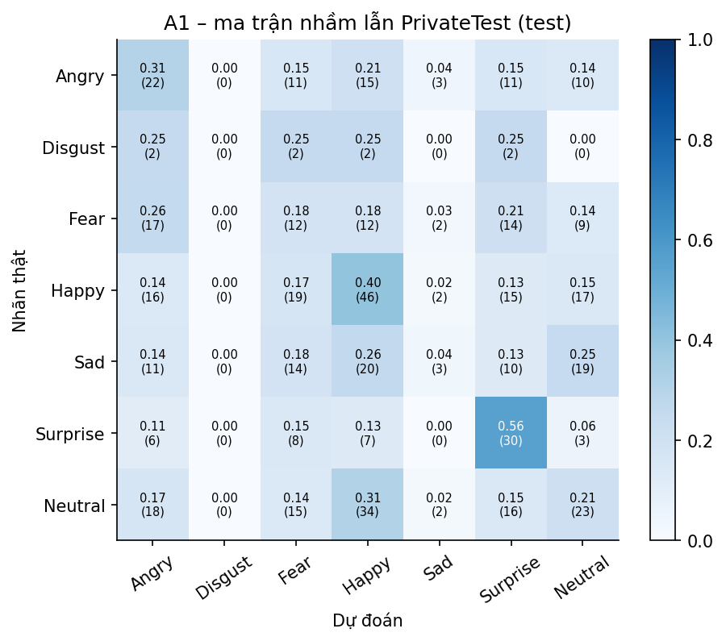
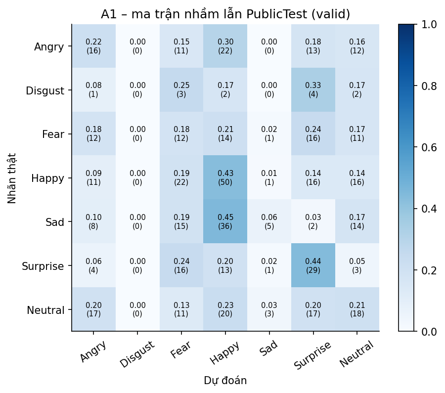
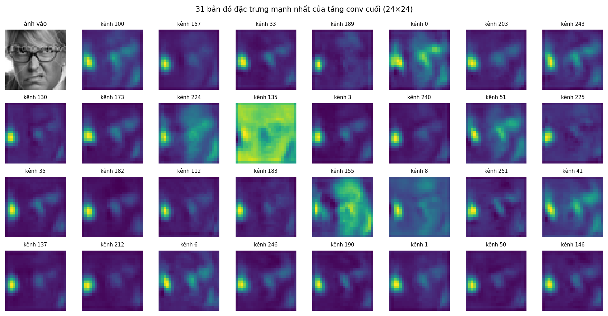
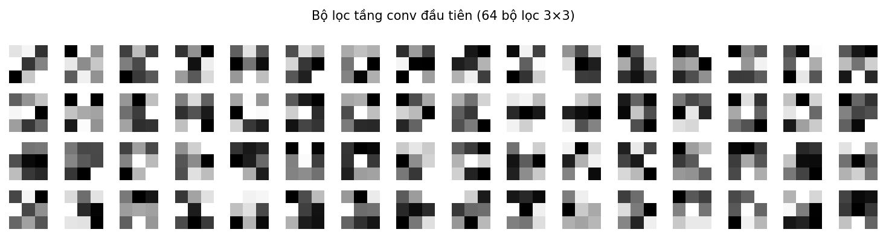
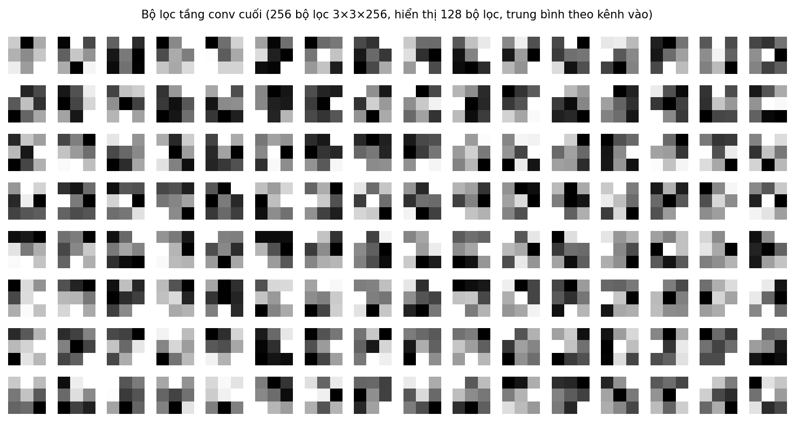
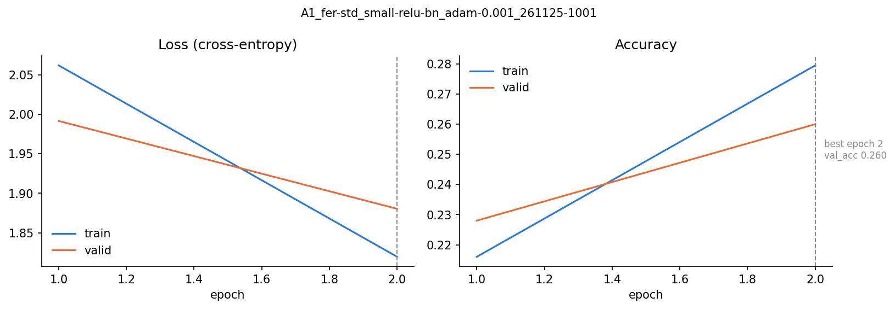
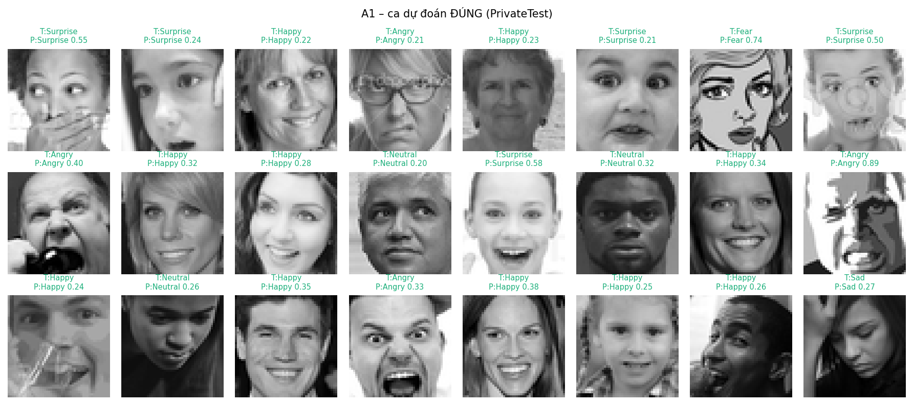
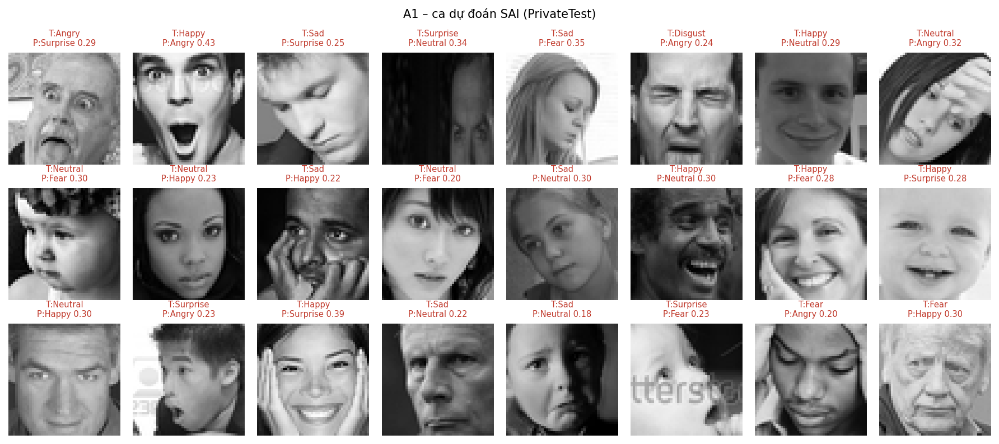

# A1_fer-std_small-relu-bn_adam-0.001_261125-1001

- **Thực nghiệm:** A1 – SMALL CNN: 2 khối (2×64 | 2×128+2×256), FC1024 (nhóm A: Kiến trúc CNN)
- **Phiên bản:** v1 · **Người chạy:** Trần Thanh Huyền · **Thời gian:** 2026-11-25T10:01:44+07:00 → 2026-11-25T10:02:05+07:00
- **Máy:** Google Colab, Linux 6.6.159+, Tesla T4, Python 3.13.16, PyTorch 2.14.1+cu130, commit `29ce7d3`
- **Lệnh:** `run_experiment.py --exp A1 --quick --author Trần Thanh Huyền`

## Kết quả

| Chỉ số | Valid (PublicTest) | Test (PrivateTest) |
|---|---|---|
| Accuracy | 0.2600 | 0.2720 |
| Loss | 1.8803 | 1.8261 |
| Macro-F1 | 0.2046 | 0.2148 |

Epoch tốt nhất (val_loss nhỏ nhất): **2** / 2 epoch · 38,903,111 tham số · 0.1 phút

## Cấu hình

```json
{
  "model": "small",
  "activation": "relu",
  "batchnorm": true,
  "dropout_conv": 0.2,
  "dropout_fc": 0.5,
  "pretrained": false,
  "image_size": 48,
  "augment": "standard",
  "optimizer": "adam",
  "lr": 0.001,
  "weight_decay": 0.0,
  "momentum": 0.9,
  "label_smoothing": 0.0,
  "batch_size": 128,
  "epochs": 2,
  "early_stopping": 10,
  "lr_patience": 4,
  "lr_factor": 0.5,
  "min_lr": 1e-06,
  "seed": 42
}
```

## Hình










Trọng số: `checkpoints/best.pt` – bản lưu trên Google Drive: https://drive.google.com/drive/folders/16lyivk-DlgbP9q31Oxg2acJtdwTRiyyV
