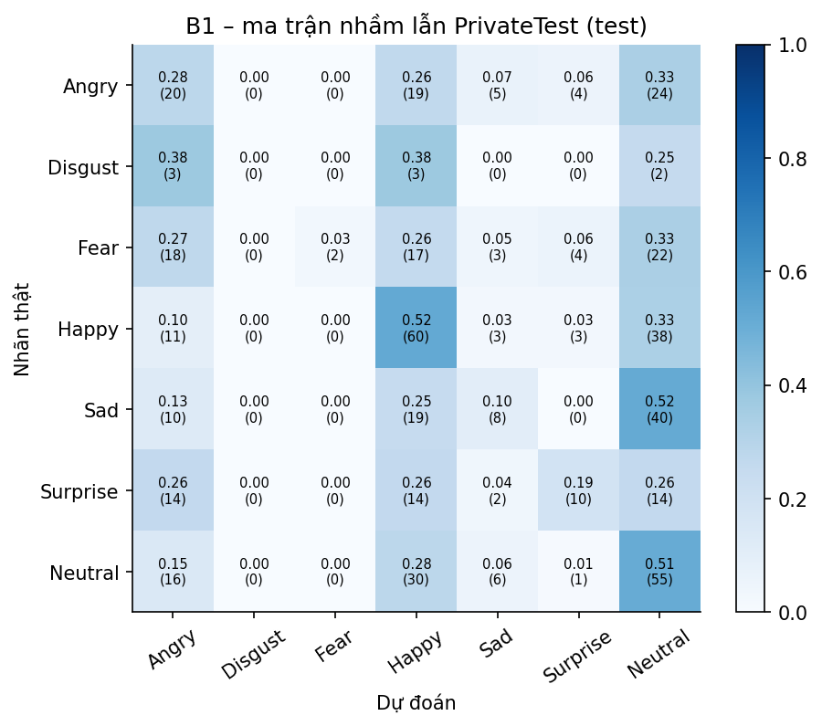
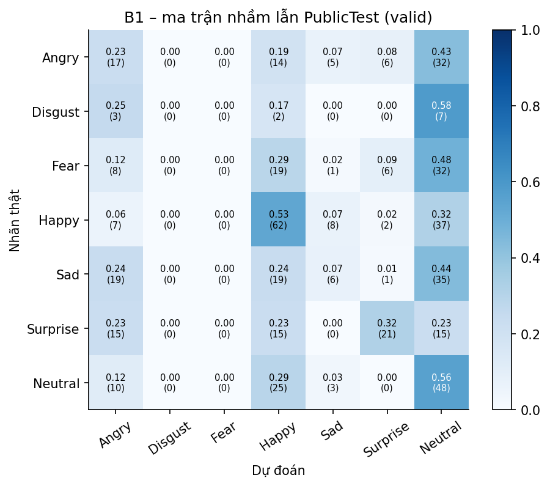
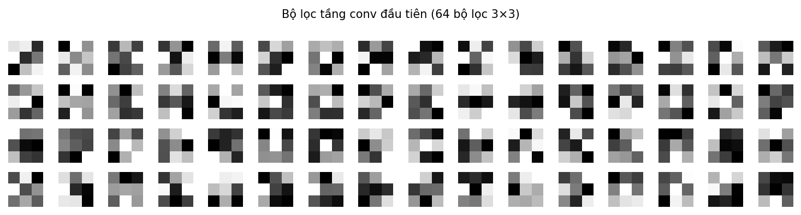
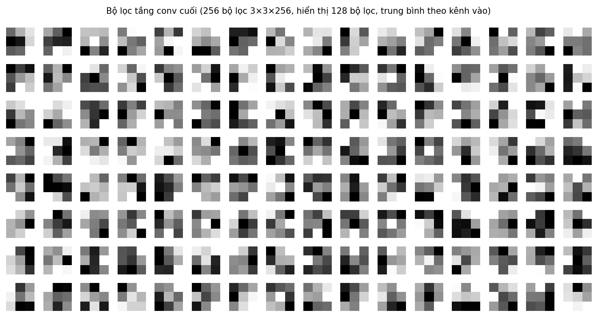
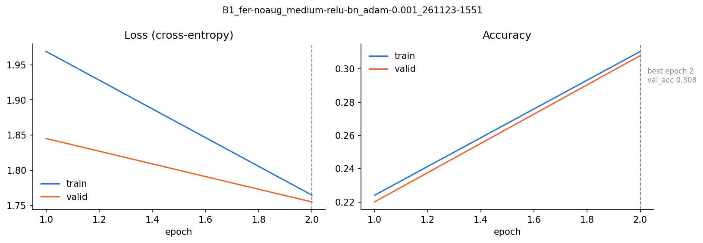

# B1_fer-noaug_medium-relu-bn_adam-0.001_261123-1551

- **Thực nghiệm:** B1 – Không tăng cường dữ liệu (nhóm B: Kỹ thuật huấn luyện)
- **Phiên bản:** v2 · **Người chạy:** Lê Châu Kỳ · **Thời gian:** 2026-11-23T15:51:35 → 2026-11-23T15:51:45
- **Máy:** Google Colab, Linux 6.6.159+, Tesla T4, Python 3.13.16, PyTorch 2.14.1+cu130, commit `d873b7f`
- **Lệnh:** `run_experiment.py --exp B1 --quick --author Lê Châu Kỳ`

## Kết quả

| Chỉ số | Valid (PublicTest) | Test (PrivateTest) |
|---|---|---|
| Accuracy | 0.3080 | 0.3100 |
| Loss | 1.7549 | 1.7332 |
| Macro-F1 | 0.2193 | 0.2166 |

Epoch tốt nhất (val_loss nhỏ nhất): **2** / 2 epoch · 11,329,607 tham số · 0.0 phút

## Cấu hình

```json
{
  "model": "medium",
  "activation": "relu",
  "batchnorm": true,
  "dropout_conv": 0.2,
  "dropout_fc": 0.5,
  "pretrained": false,
  "image_size": 48,
  "augment": "none",
  "optimizer": "adam",
  "lr": 0.001,
  "weight_decay": 0.0,
  "momentum": 0.9,
  "label_smoothing": 0.0,
  "batch_size": 128,
  "epochs": 2,
  "early_stopping": 10,
  "lr_patience": 4,
  "lr_factor": 0.5,
  "min_lr": 1e-06,
  "seed": 42
}
```

## Hình







Trọng số: `checkpoints/best.pt` – bản lưu trên Google Drive: https://drive.google.com/drive/folders/16lyivk-DlgbP9q31Oxg2acJtdwTRiyyV
