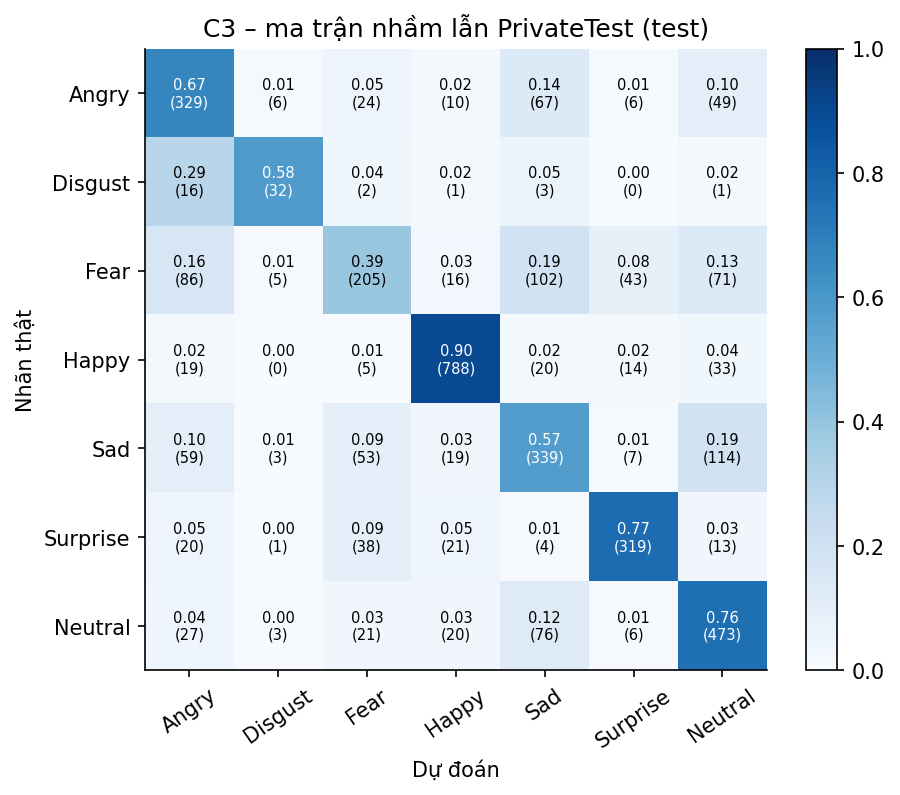
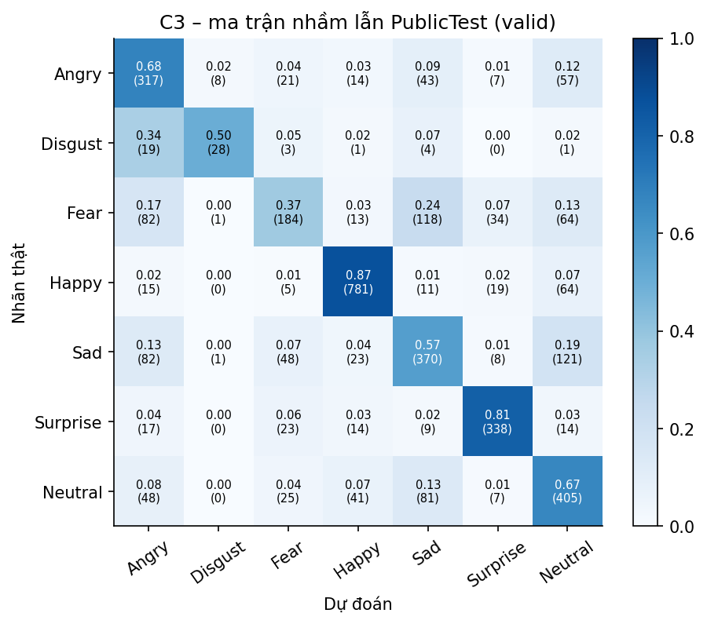
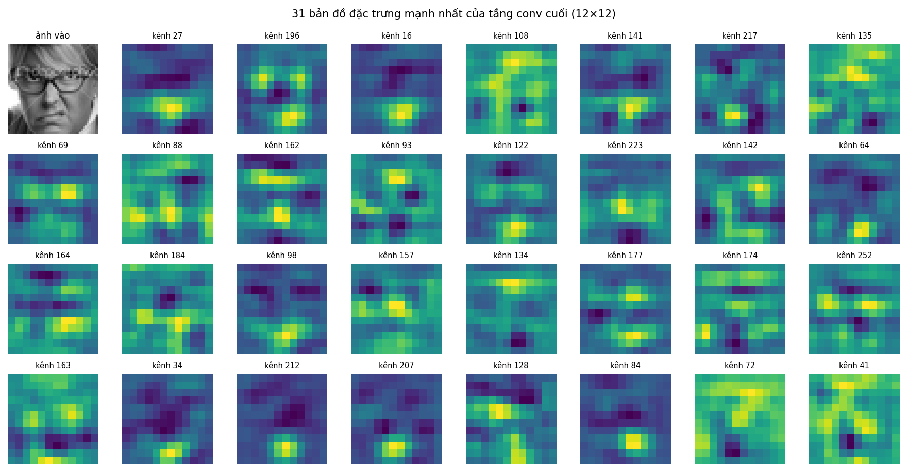
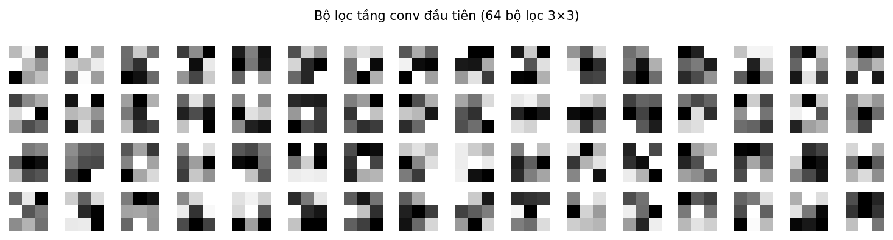
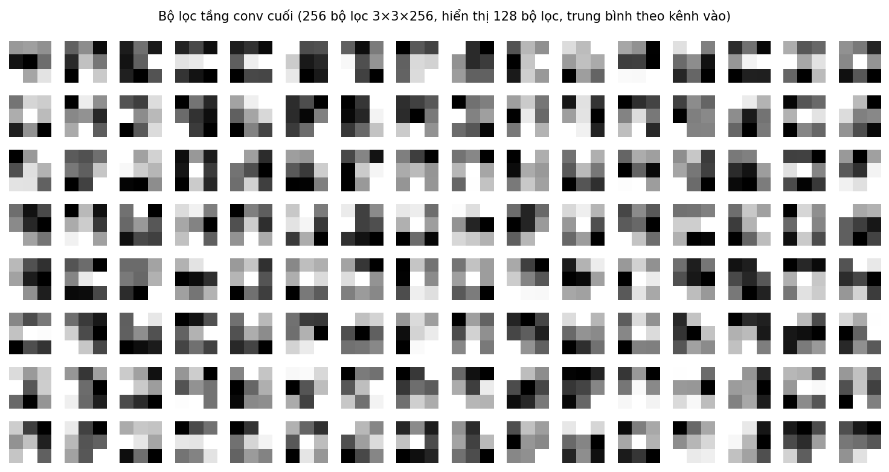
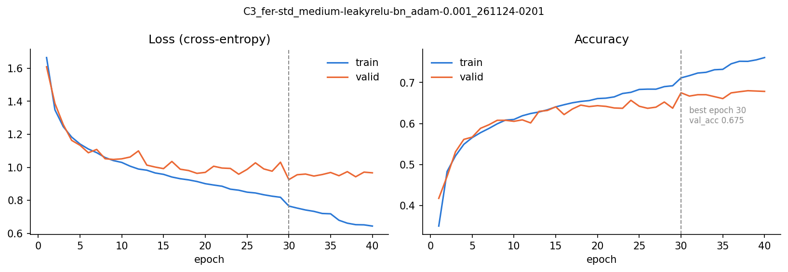
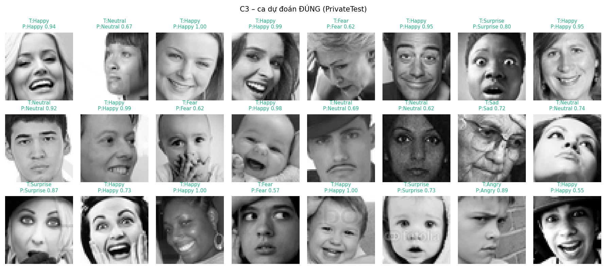
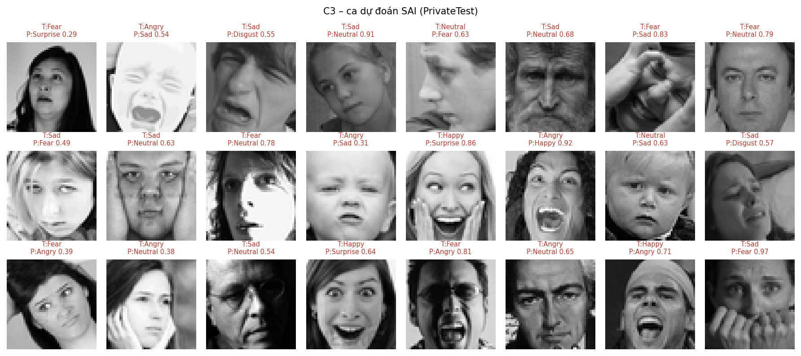

# C3_fer-std_medium-leakyrelu-bn_adam-0.001_261124-0201

- **Thực nghiệm:** C3 – Hàm kích hoạt LeakyReLU(0.1) thay ReLU (nhóm C: Hàm kích hoạt và điều chuẩn)
- **Phiên bản:** v1 · **Người chạy:** Vũ Hoàng Phương · **Thời gian:** 2026-11-24T02:01:47+07:00 → 2026-11-24T02:09:43+07:00
- **Máy:** Google Colab, Linux 6.6.159+, Tesla T4, Python 3.13.16, PyTorch 2.14.1+cu130, commit `29ce7d3`
- **Lệnh:** `run_experiment.py --group C --author Vũ Hoàng Phương --note `

## Kết quả

| Chỉ số | Valid (PublicTest) | Test (PrivateTest) |
|---|---|---|
| Accuracy | 0.6751 | 0.6924 |
| Loss | 0.9253 | 0.8622 |
| Macro-F1 | 0.6476 | 0.6628 |

Epoch tốt nhất (val_loss nhỏ nhất): **30** / 40 epoch · 11,329,607 tham số · 7.7 phút

## Cấu hình

```json
{
  "model": "medium",
  "activation": "leakyrelu",
  "batchnorm": true,
  "dropout_conv": 0.2,
  "dropout_fc": 0.5,
  "pretrained": false,
  "image_size": 48,
  "augment": "standard",
  "optimizer": "adam",
  "lr": 0.001,
  "weight_decay": 0.0,
  "momentum": 0.9,
  "label_smoothing": 0.0,
  "batch_size": 128,
  "epochs": 60,
  "early_stopping": 10,
  "lr_patience": 4,
  "lr_factor": 0.5,
  "min_lr": 1e-06,
  "seed": 42
}
```

## Hình










Trọng số: `checkpoints/best.pt` – bản lưu trên Google Drive: https://drive.google.com/drive/folders/16lyivk-DlgbP9q31Oxg2acJtdwTRiyyV
