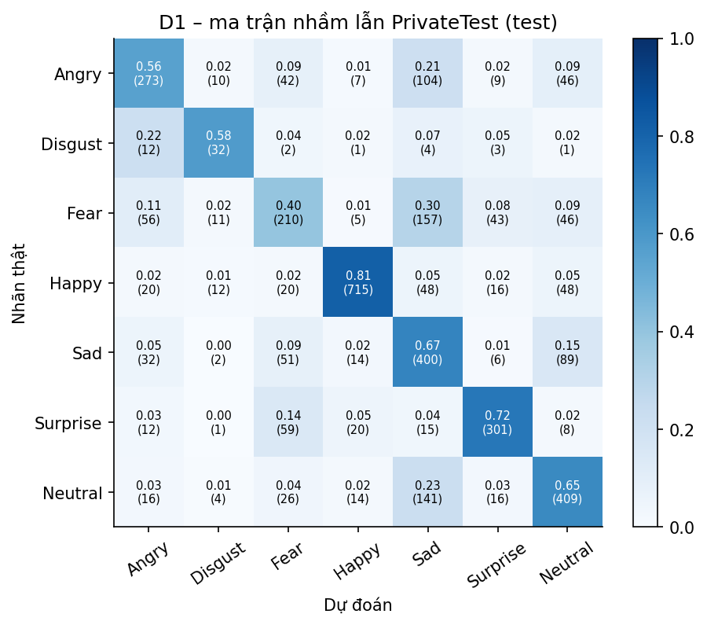
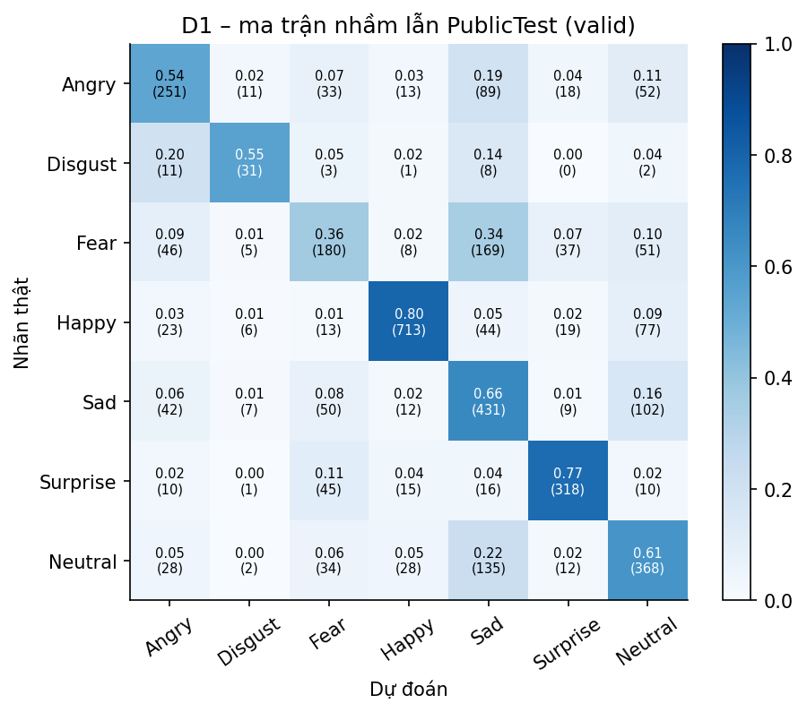
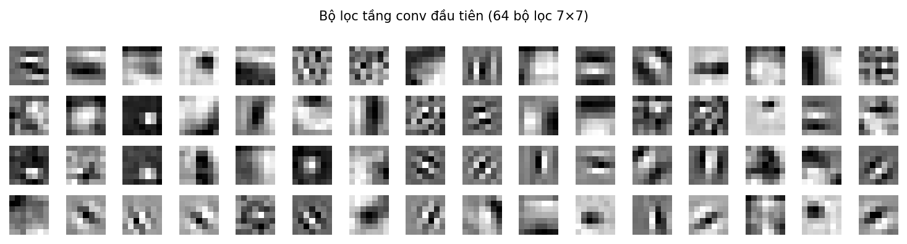
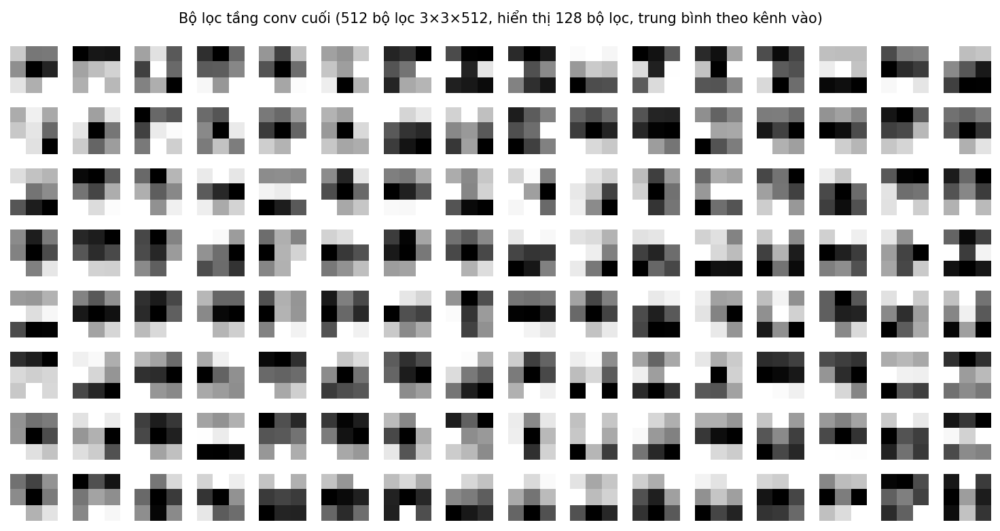
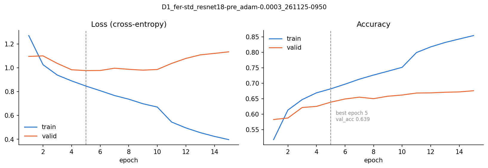
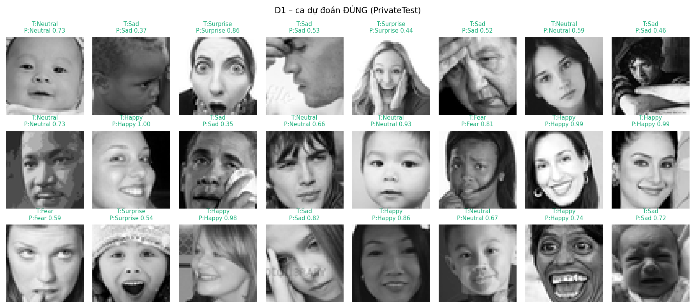
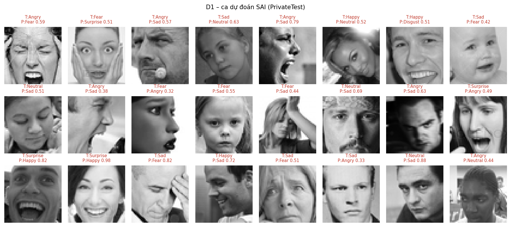

# D1_fer-std_resnet18-pre_adam-0.0003_261125-0950

- **Thực nghiệm:** D1 – ResNet18 tiền huấn luyện ImageNet, fine-tune, ảnh 96×96 (nhóm D: Học chuyển giao)
- **Phiên bản:** v1 · **Người chạy:** Đỗ Minh Thương · **Thời gian:** 2026-11-25T09:50:20+07:00 → 2026-11-25T09:53:01+07:00
- **Máy:** Google Colab, Linux 6.6.159+, Tesla T4, Python 3.13.16, PyTorch 2.14.1+cu130, commit `29ce7d3`
- **Lệnh:** `run_experiment.py --group D --author Đỗ Minh Thương --note `

## Kết quả

| Chỉ số | Valid (PublicTest) | Test (PrivateTest) |
|---|---|---|
| Accuracy | 0.6386 | 0.6520 |
| Loss | 0.9764 | 0.9491 |
| Macro-F1 | 0.6095 | 0.6210 |

Epoch tốt nhất (val_loss nhỏ nhất): **5** / 15 epoch · 11,180,103 tham số · 2.5 phút

## Cấu hình

```json
{
  "model": "resnet18",
  "activation": "relu",
  "batchnorm": true,
  "dropout_conv": 0.2,
  "dropout_fc": 0.5,
  "pretrained": true,
  "image_size": 96,
  "augment": "standard",
  "optimizer": "adam",
  "lr": 0.0003,
  "weight_decay": 0.0,
  "momentum": 0.9,
  "label_smoothing": 0.0,
  "batch_size": 128,
  "epochs": 60,
  "early_stopping": 10,
  "lr_patience": 4,
  "lr_factor": 0.5,
  "min_lr": 1e-06,
  "seed": 42
}
```

## Hình









Trọng số: `checkpoints/best.pt` – bản lưu trên Google Drive: https://drive.google.com/drive/folders/16lyivk-DlgbP9q31Oxg2acJtdwTRiyyV
